# 📧 Email Automation & Reminder System

A Python project that schedules and sends automated emails (one-off or recurring), tracks delivery status, and reports results. It works in two ways:

1. **CLI version**: CSV contacts and reminders, template personalization, SMTP sending, logs and a CSV report.
2. **Full-stack version**: FastAPI backend, SQLite database, background scheduler and a Next.js dashboard.

A safe **dry-run mode** is the default, so you can test everything without sending a single real email.

---

## 🎯 Problem Statement

Teams waste time manually sending repetitive emails such as class reminders, payment follow-ups, meeting alerts and deadline notices. Manual sending causes missed deadlines, inconsistent messages and no record of what was sent. This project automates the whole flow:

```
contact list → message template → scheduled reminder → email sending → status tracking → report
```

## 🏭 Industry Relevance

Used by trainers, HR, sales, operations and support teams for:
- Class / webinar / meeting reminders
- Payment and invoice reminders
- Task and deadline notifications
- Follow-ups and onboarding emails

It demonstrates job scheduling, templating, idempotency, retries, SMTP integration, REST APIs and observability, which are common backend and automation skills.

---

## ✨ Features

- CSV contacts and reminders (Pandas), with email validation
- `{{placeholder}}` templates (`{{name}}`, `{{title}}`, `{{event_date}}`, ...)
- Recurrence: **once / daily / weekly**, plus RFC 5545 **RRULE** support in the API
- **Dry-run mode** (default): no real emails, `.eml` previews saved
- **Idempotent scheduling**: one message per reminder firing, so no duplicate sends
- Retries (up to 3), with no retry on authentication errors
- Unsubscribed contacts are skipped automatically
- Separate `sent.log` / `failed.log` and a CSV report
- REST API with auto-generated Swagger docs
- Next.js dashboard with live status badges and CSV export
- Secrets via environment variables (`.env`), never committed
- Automated unit tests for the scheduling engine

## 🧰 Tech Stack

| Layer | Tools |
|---|---|
| Language | Python 3.10+ |
| CLI version | Pandas, smtplib, email.message, schedule, logging, python-dotenv |
| API | FastAPI, Uvicorn, Pydantic |
| Database | SQLite (`sqlite3`) |
| Scheduling | Background thread, python-dateutil (RRULE) |
| Dashboard | Next.js 14, React 18 |
| Testing | unittest |

## 🏗️ Architecture (Full-stack version)

```
Browser (Next.js :3000) --/api proxy--> FastAPI (:8000) --> SQLite (db/email.db)
                                            |
                                background scheduler (every 30 s)
                                plan():     due reminders -> messages (unique per firing)
                                dispatch(): render -> SMTP or dry-run -> update status
```

Times are stored in **UTC** and shown in the browser's local time.

## 📁 Folder Structure

```
Email-Automation-Reminder-System/
├── api/              # FastAPI app, SQLite layer, scheduler engine, demo seeding
├── data/             # contacts.csv, reminders.csv (dummy data)
├── db/               # SQLite database (created at runtime, git-ignored)
├── docs/             # extra documentation
├── images/           # screenshots used in this README
├── logs/             # email_automation.log, sent.log, failed.log
├── outputs/          # report.csv and .eml email previews
├── src/              # CLI engine: loader, templating, mailer, runner, reporter
├── templates/        # email templates (.txt)
├── tests/            # unit tests
├── web/              # Next.js dashboard
├── main.py           # CLI entry point
├── requirements.txt
├── .env.example
└── .gitignore
```

---

## ⚙️ Setup

```bash
# 1. Clone
git clone https://github.com/Shrishti-Gupta-ece/email-automation-reminder-system.git
cd email-automation-reminder-system

# 2. Virtual environment
python -m venv venv
venv\Scripts\activate          # Windows
source venv/bin/activate       # Mac / Linux

# 3. Install dependencies
python -m pip install -r requirements.txt
```

> On Windows, if `pip` is blocked, use `python -m pip` and `python -m uvicorn` so the virtual environment's Python is used.

### Environment variables

Copy `.env.example` to `.env` (only needed for real emails):

```env
SMTP_HOST=smtp.gmail.com
SMTP_PORT=587
SMTP_USER=your_email@gmail.com
SMTP_PASS=your_gmail_app_password
SENDER_NAME=Python Course Team
DRY_RUN=true
```

Use a Gmail **App Password** (requires 2-Step Verification), never your normal password. `.env` is git-ignored.

---

## ▶️ How to Run

### A) CLI version

```bash
python main.py --all          # dry-run, process every reminder
python main.py                # dry-run, only reminders that are due
python main.py --schedule     # keep running, check every minute
python main.py --live         # send REAL emails (needs .env)
```

### B) Full-stack version

Terminal 1 (project root, venv active):
```bash
python -m uvicorn api.main:app --reload
```
API docs: http://127.0.0.1:8000/docs

Terminal 2:
```bash
cd web
npm install
npm run dev
```
Dashboard: http://localhost:3000

Click **Load demo data**. Demo reminders fire one per minute, and messages appear live on the dashboard.

### C) Run tests

```bash
python -m unittest discover tests -v
```

---

## 📤 Sample Output

```
[DRY RUN] R001 -> aarav.sharma@example.com | Reminder: Python Live Class on 2026-11-22 at 7:00 PM
[DRY RUN] R003 -> rohan.mehta@example.com | Action needed: Invoice INV-1042 Payment due 2026-11-25
R005 skipped: karan.singh@example.com is unsubscribed
[FAILED] R008 -> priya.verma@example.com | Template 'missing_template' not found in templates/
Run complete: {'sent': 5, 'failed': 2, 'skipped': 1}
```

`outputs/report.csv` columns: `timestamp, reminder_id, occurrence, name, email, subject, status, mode, error`

## 🔌 API Endpoints

| Method | Endpoint | Purpose |
|---|---|---|
| GET | `/health` | Service status and mode |
| GET / POST / DELETE | `/contacts` | Manage contacts |
| GET / POST / DELETE | `/templates` | Manage templates |
| GET / POST / DELETE | `/reminders` | Manage reminders |
| POST | `/reminders/{id}/toggle` | Enable or disable a reminder |
| GET | `/messages` | Message history and status |
| GET | `/messages/export.csv` | Download CSV report |
| GET | `/stats` | Dashboard counters |
| POST | `/run-now` | Run the scheduler immediately |
| POST | `/demo/load` | Load demo data from CSV files |

---

## 📸 Screenshots

### Project structure
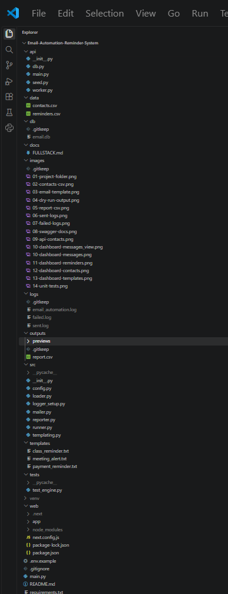

### Input data and template
| Contacts CSV | Email template |
|---|---|
| 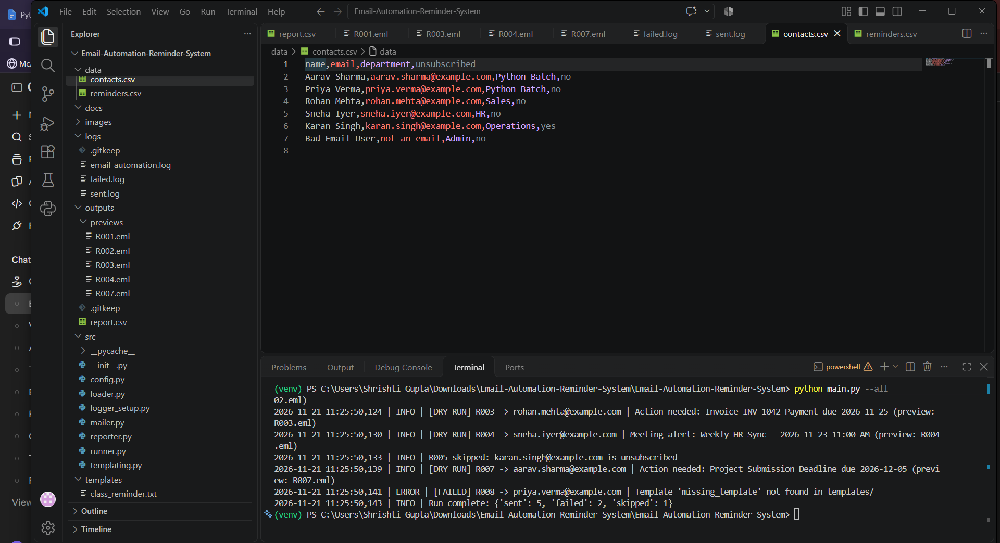 | 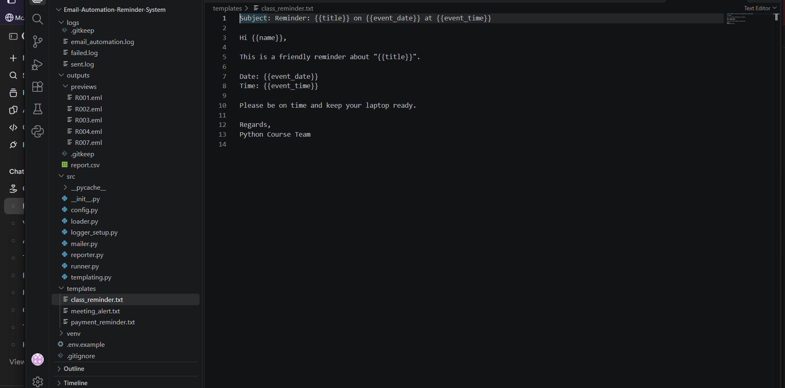 |

### CLI dry-run
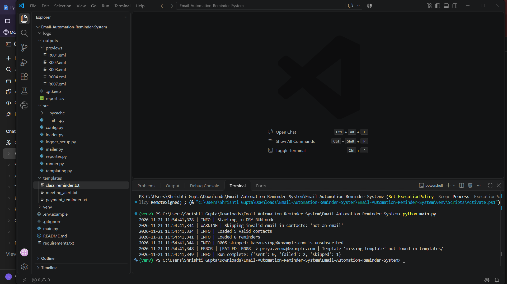

### Reports and logs
| Report CSV | Sent log | Failed log |
|---|---|---|
| 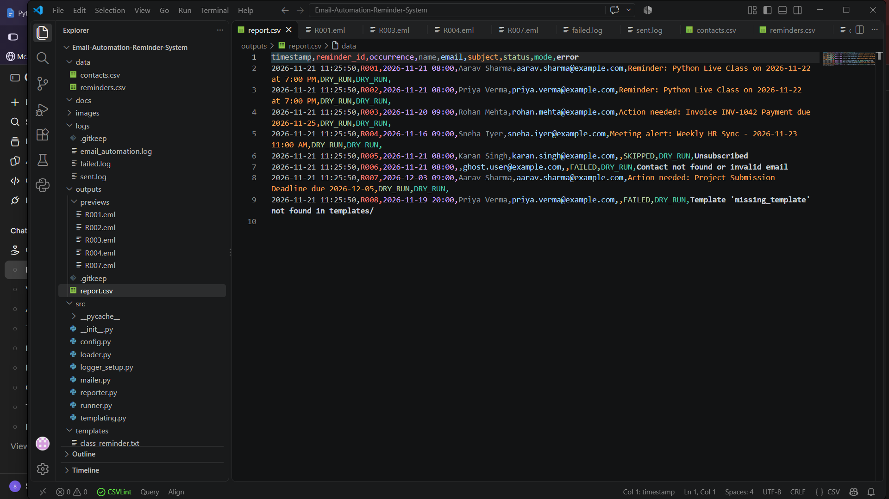 | 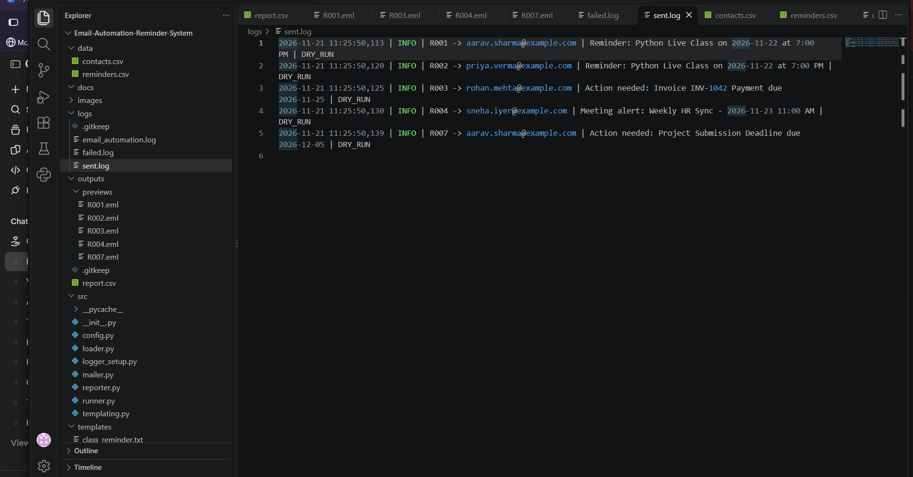 | 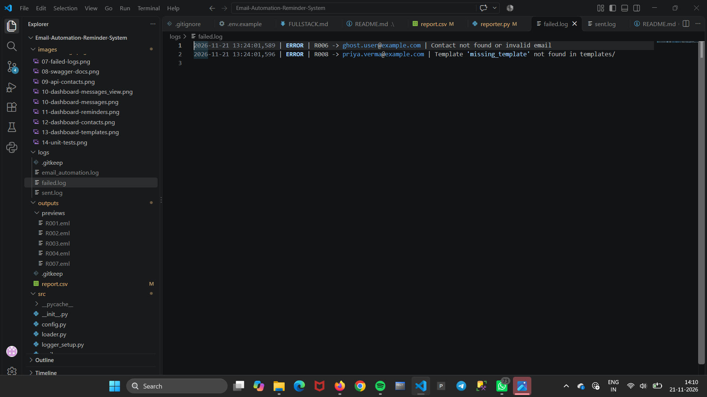 |

### FastAPI backend
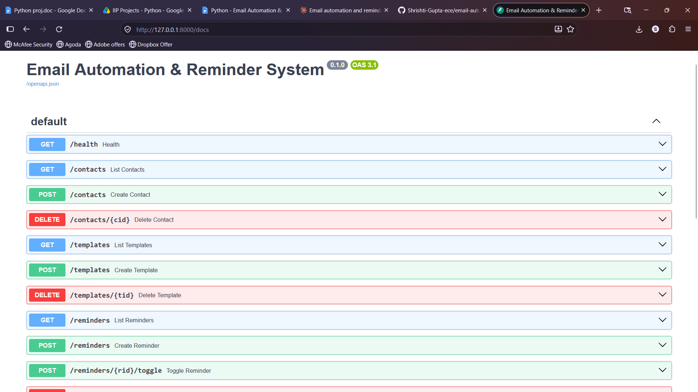
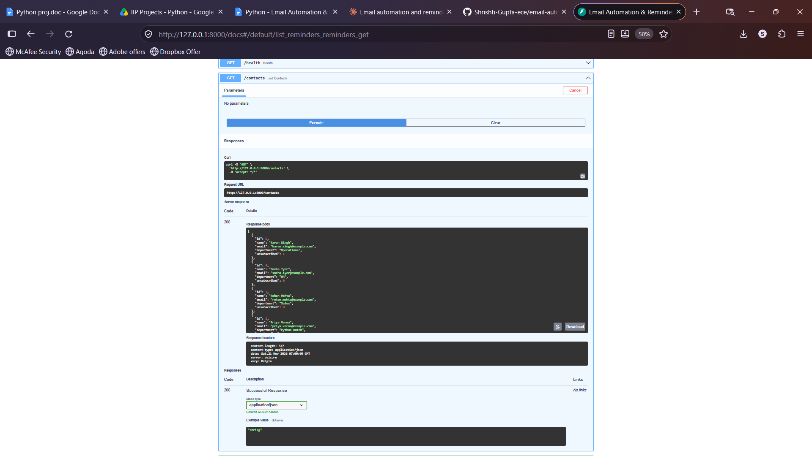

### Next.js dashboard
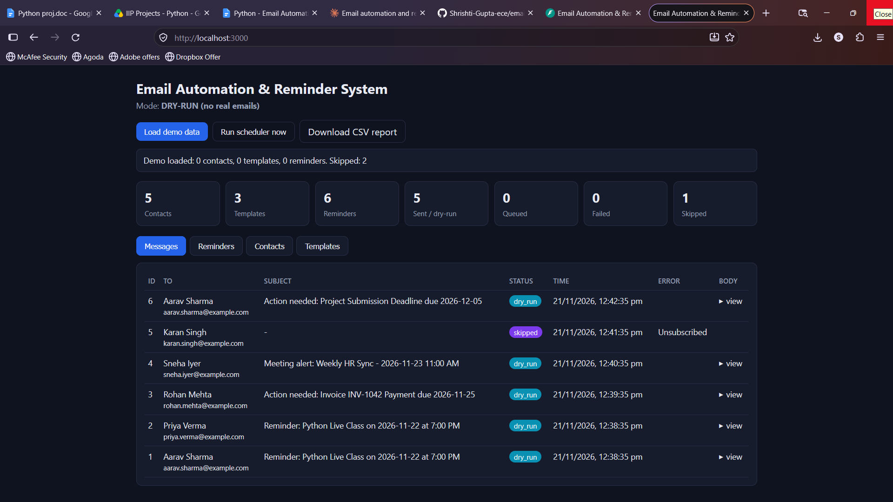

| Reminders | Contacts | Templates |
|---|---|---|
| 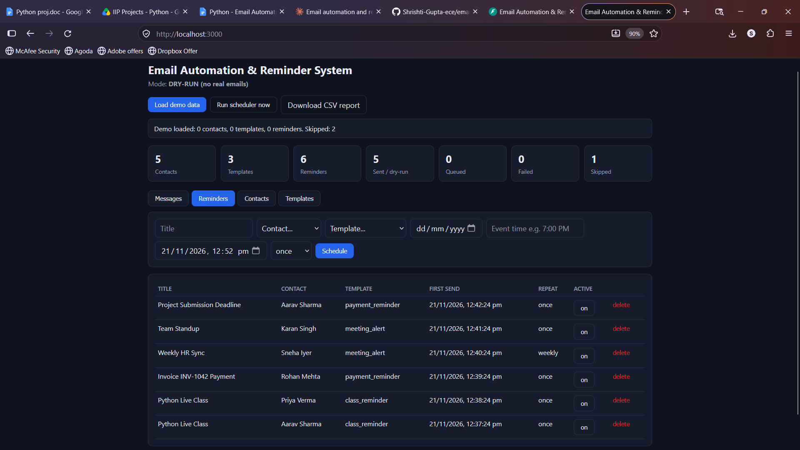 | 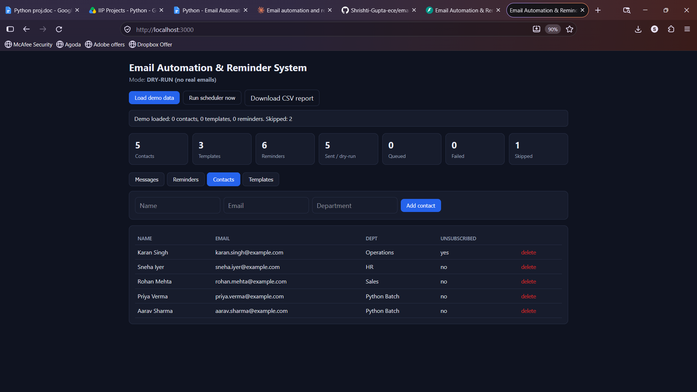 | 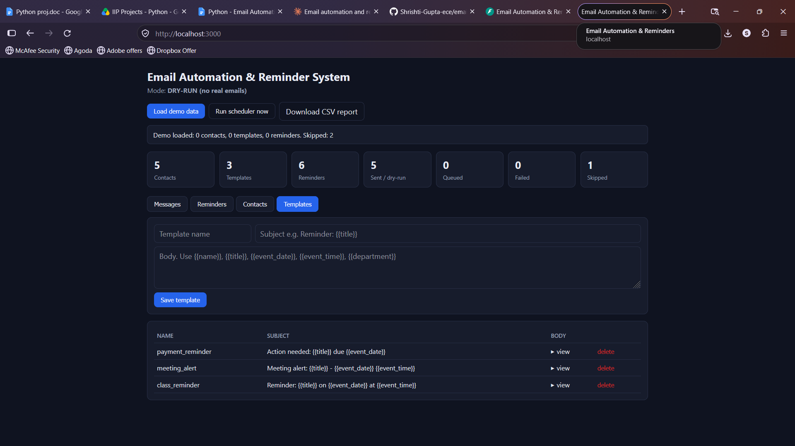 |

### Unit tests
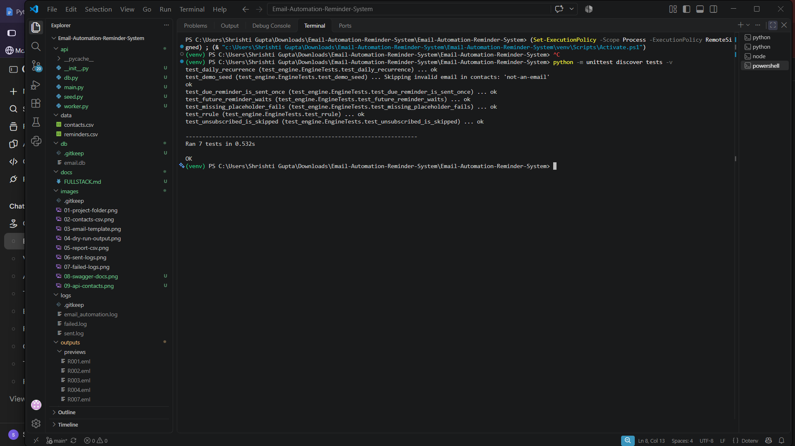

---

## 🔒 Security Notes

- Never commit `.env`, passwords, or real customer data. Only `.env.example` is committed.
- All sample contacts use `example.com` addresses.
- Dry-run is the default, so real emails are sent only with `--live` or `DRY_RUN=false`.
- The `npm audit` warnings come from development dependencies and are for local demo use only.

## 📚 Learning Outcomes

- Reading and validating CSV data with Pandas
- Template-based personalization
- Sending email with SMTP (`smtplib`, `email.message`)
- Scheduling: one-off, recurring, RRULE
- Idempotency, retries and error handling
- Logging and report generation
- Building a REST API with FastAPI and a SQLite schema
- Building a Next.js dashboard that talks to an API
- Unit testing the core logic
- Git and GitHub workflow with safe secret handling

## 🚀 Future Improvements

- Authentication for the dashboard and API
- Migrate to Postgres and SQLAlchemy, or APScheduler
- Open and click tracking
- Attachments and ICS calendar invites
- SMS / WhatsApp reminders
- Per-contact timezone sending
- Docker and cloud deployment

---

⭐ If you found this project useful, consider starring the repository.
